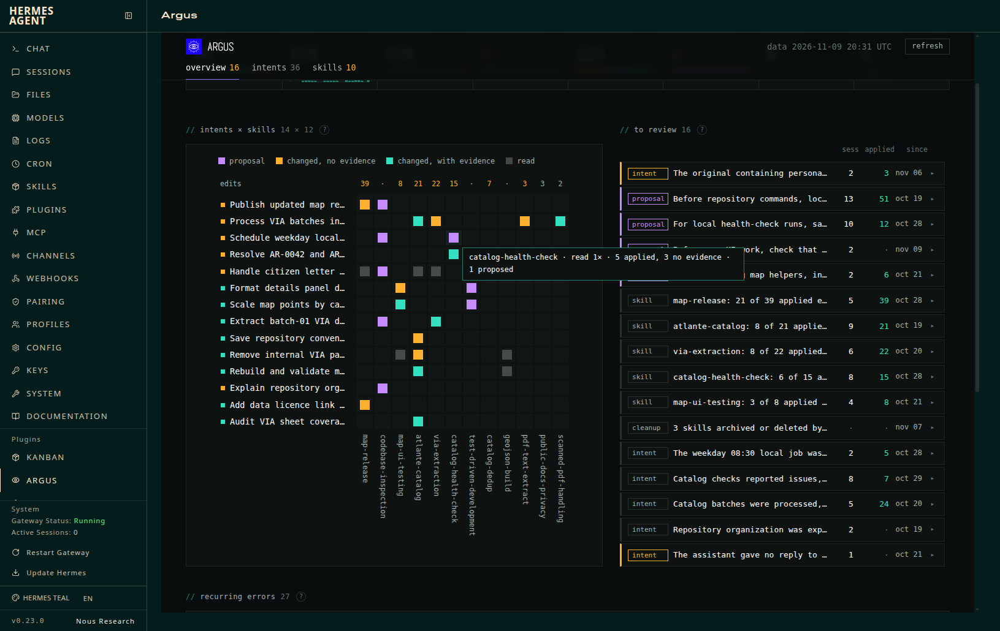

# Argus (Hermes plugin)

Argus reads a Hermes agent by **intents** instead of sessions and lets a person decide what to keep
of what it learns. It groups the agent's turns into intents (one goal, possibly over many turns,
sessions and days), shows which skills each intent read and taught, flags skill edits Hermes applied
without evidence and proposes edits of its own. A person keeps or rejects each edit and accepts or
dismisses each proposal; nothing changes a skill without that.



What an intent is, how Hermes learns and what Argus checks of it: the
[repository README](../README.md) ("Intents", "Learning") and a
[walkthrough from a flagged skill to an approved rule](../docs/showcase.md); storage: [docs/data-model.md](../docs/data-model.md).

## Install

> **Cost: derive can be expensive.** It makes one model call per session with new turns and per
> skill edit Hermes applied, then judges the intents those turns land in and, for an intent with 3
> or more sessions, each of its runs, on the `auxiliary.argus` slot (unset: the curator's model).
> On one busy personal agent (856 skill edits a week) a first derive over 2 days of history made
> 238 calls; 7 days would have been about 750 (635 edits to review), 20 days about 2,500 (291
> sessions, 2,166 ledger entries). Start with `--since 2` to `--since 7` on a busy agent: backfill
> and `hermes argus status` print the calls the next derive makes before it runs, the part known
> now and an upper bound, and a later `--since` widens the window. The window never narrows, so a
> too-wide first backfill commits that profile to its cost (without `--since`, the first backfill
> takes `since_days`, 30).

Needs Hermes 0.22.5 or newer, on Linux or macOS (derive and apply lock with `flock`; native Windows
is not supported). Install it as the user Hermes runs as, from its repository, or from the plugin
catalog once it is listed there:

```bash
hermes plugins install albertodvp/argus#argus   # or, once in the catalog: hermes plugins install argus
```

Or copy this directory to `$HERMES_HOME/plugins/argus/` (default `~/.hermes`) and enable it. Then:

```bash
hermes plugins enable argus      # Nix-installed Hermes: add argus to plugins.enabled in config.yaml instead
hermes argus backfill --since 3  # sets the active profile's history window, read-only; prints the next derive's calls
hermes argus derive              # model passes on the `auxiliary.argus` slot (`hermes model`)
hermes argus status              # rows per profile, last backfill and derive, history window, next derive's calls
hermes argus export --out data.js
hermes argus apply --proposal <id> [--dry-run]   # carry out an accepted proposal (or --rollback <entry>)
```

`-p <profile>` selects the profile, `--all` runs backfill/derive on every profile of the install.
In the agent, `/argus` shows the intent of the current session and what waits for review; on a
messaging platform, where anyone allowed in the chat can ask, it shows only the session's intents,
without the judge's advice or the profile's counts. A running dashboard shows the tab after
Plugins → Rescan dashboard extensions. After updating Argus, restart `hermes dashboard`: until then
its Argus API answers 503 instead of mixing the two versions. `hermes plugins remove argus` keeps
each profile's `plugin-data/argus/`; delete those directories to drop the data too.

History window: a profile's first backfill sets it (meta `window_start`) to `--since DAYS`, or to
the last `since_days` days (setting, default 30). A later `--since` widens it and reads the older
sessions (`--since 0`: the whole history); a narrower one is reported, never applied. Derive, export
and the status counts read only sessions with a message in the window. Derive skips a profile never
backfilled (idle trigger and dashboard refresh included); on the others it first catches up with
the tool outcomes and ledger entries since the last backfill, which keeps profiles without the
plugin (no hooks there) current. Skills are found where Hermes finds them: the profile's `skills/`,
then `skills.create_dir` and `skills.external_dirs` from its `config.yaml`. A Hermes run in a
container or behind a wrapper needs that instance's own CLI in place of `hermes`.

## What Argus does on your machine

What a user should know before installing (catalog rule 13):

- **Model calls.** `hermes argus derive` (by hand, from the idle trigger or from the dashboard's
  refresh) calls the model of the `auxiliary.argus` slot through `ctx.llm`; unset, the curator's
  model. Its prompts carry text of the agent's turns: user messages and replies, the start of each
  tool call's arguments (120 characters) and of each tool result (220 characters), and tool error
  lines; these can hold commands, paths or other values the agent used. They also carry skill
  diffs from the curator ledger and, for a proposal, the current
  `SKILL.md` of that skill. One pass uses one slot for every profile it derives: with `--all` and
  from the dashboard's refresh, the turns of every backfilled profile go to the `auxiliary.argus`
  model of the profile that runs the pass. How many calls: [Install](#install); backfill and
  `status` print the next pass's count. After 5 model errors in a row (provider down, quota) the
  pass stops and exits non-zero. Argus makes no other network request and sends no telemetry.
- **Reads outside its own data, read-only.** Each profile's `state.db`, the curator ledger
  `skills/.curator_ledger.jsonl` and its blob store `.curator_backups/blobs/`, the `skills` section
  of its `config.yaml` (`create_dir`, `external_dirs`), the `SKILL.md` files of its skill
  directories and staged writes under `pending/skills/`. With `--all`, and always in the dashboard,
  that is every profile of the install, including profiles that do not enable Argus. The dashboard
  tells whether a derive pass is running from the profiles' `derive.lock`, and whether Argus changed
  on disk from the files of its own directory.
- **Writes.** `plugin-data/argus/` in each profile it reads (SQLite database, run reports, logs,
  locks). Skills and the ledger change only on an apply (below).
- **Background processes.** After a turn, when the agent has been idle `idle_minutes` and no pass
  ran for `interval_minutes`, Argus starts a detached `hermes -p <profile> argus derive --quiet`, one
  at a time (`derive.lock`); the dashboard's refresh starts `hermes argus derive --all --quiet` the
  same way. Each exits when its pass ends. Nothing in them waits for a person, so they are safe
  under cron and the gateway. The dashboard's apply button runs `apply_child.py` with the install's
  Python and `HERMES_HOME` set to the decision's profile, stopped after 45 seconds. These are the
  only processes Argus starts, each from an argument list, never through a shell.
- **Skill writes.** Only after a person decides and then clicks apply (the confirmation shows the
  lines it inserts) or runs `hermes argus apply`. A rejected edit is undone with Hermes'
  `rollback_entry`, the same restore as `hermes curator rollback`, refused when the file changed
  after that entry (Hermes refuses one outside the profile's home, e.g. in `skills.external_dirs`).
  An accepted proposal goes through `skill_manage(action="patch")`, which refuses a
  locked skill and, with `skills.write_approval` on, only stages the write for `/skills approve`;
  apply refuses it when its rule or diff changed after the person accepted it, and when the skill's
  `SKILL.md` or directory is not writable here (a shared `skills.external_dirs` is often read-only:
  the dashboard marks those proposals read-only, to carry to wherever that skill is maintained).
  Ledger actor: `user`. The dashboard's copy buttons give terminal commands with every value
  shell-quoted.
- **Credentials.** None read, stored or requested.

## What runs where

| Module | Role |
|---|---|
| `capture.py` | hooks (`pre_llm_call`, `post_tool_call`, `on_session_end`, `on_skill_lifecycle`, `on_session_delete`); enqueue rows only, never call a model |
| `backfill.py` | `tool_outcome` from state.db tool messages, `skill_edit` from the curator ledger; idempotent, cursor in `meta`; sets and widens the history window (`window_start` in `meta`) |
| `derive.py` | intents, runs, edit reviews, proposals |
| `hermes_data.py` | read-only state.db / ledger / blob access, column check |
| `store.py` | `<home>/plugin-data/argus/data.db` (schema `schema.sql`), write queue |
| `apply.py` | `hermes argus apply` and the dashboard's apply button: `rollback_entry` / `skill_manage` patch or create (new skill) as ledger actor `user`, checks first (current decision, no later change, context unchanged, rule not yet present), one row per attempt in `apply_log` |
| `apply_child.py` | the dashboard's apply process: `apply.run` with HERMES_HOME = the decision's profile, so it works in profiles that do not enable the plugin |

After a turn, when the agent has been idle `idle_minutes` (default 10) and no pass ran for
`interval_minutes` (default 60), a detached `hermes argus derive --quiet` starts (one at a time,
`plugin-data/argus/derive.lock`, output in `derive.log`). Settings live under
`plugins.entries.argus.settings`.

Argus never writes state.db or the ledger itself; `hermes argus apply` changes a skill, and so the
ledger, only through Hermes' `skill_manage` / `rollback_entry`.
