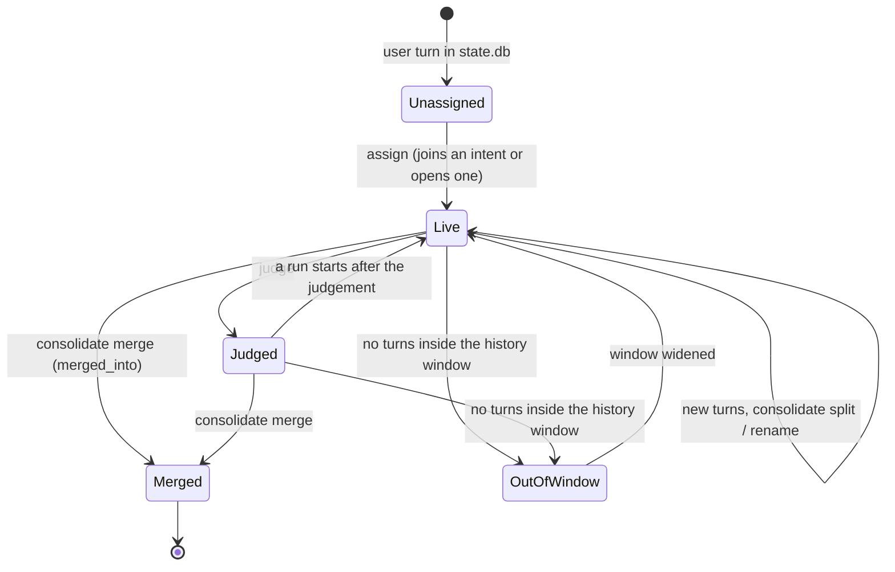

# Intents in detail

The README gives the short version. This page has the rules, the fields and the lifecycle as the
code implements them (`argus/derive.py`, prompts in `argus/prompts.py`).

## What is a turn, a run, an intent

- **Turn.** One user message in `state.db` and the replies up to the next one. Hermes' own injected
  messages (context compaction, `/goal` continuations, `[System: …]` notes) are not turns.
- **Intent.** One expected result. The same result is the same intent whatever the wording,
  including refinements and corrections. A different deliverable is a new intent, even inside one
  conversation. A project is not an intent.
- **Run.** One session of an intent. The same request repeated later is a new run of the same intent.
- **Routine.** Every session of one cron job belongs to one intent of kind `routine`.
- **Subagents.** A subagent session is not a turn; it is shown under the intent of the turn that
  spawned it.
- **Profiles.** Each profile has its own `state.db` and its own plugin data: the same goal pursued in
  two profiles is two intents.

## Fields

| Field | Values | Source |
|---|---|---|
| title, goal | plain text | model, at creation; consolidation may rename |
| kind | `task`, `probe`, `chat`; `routine` | model; rule for cron |
| who | `real-user`, `team`, `automated-test`, `scheduled` | model |
| runs | `signal_status`: ok, error, interrupted, cron_failure, silent | evidence only; for intents with 3+ sessions also a one-line model result per run |
| judgement | status (achieved, partial, failed, unclear), stability (stable, unstable, single-run), risk, headline, friction, next step, attention 0–3 | model |
| skills read | `skill_view` calls in its turns | evidence |
| skills taught | ledger edits written in its sessions (a subagent's count for its parent's intent) | evidence |

## Lifecycle

No model runs in a hook. The passes run in `hermes argus derive`: when the agent has been idle
`idle_minutes` (10), at most every `interval_minutes` (60), or by hand, on the `auxiliary.argus`
model slot, with a report per run. Of its six stages (assign, consolidate, judge, runs, edit review,
proposals) the first four make intents.

1. **Unassigned.** Hooks record how the turn's tool calls and the turn ended. Until the next derive,
   `/argus` says the session has no intent yet.
2. **Assign** (incremental). Rules first, at no cost; every link records the gate that made it:

   | Gate | Rule |
   |---|---|
   | `cron` | a cron session joins its routine |
   | `follow-up` | 25 characters or less, or "ok", "go", "procedi", …: joins its session's current intent |
   | `repeat` | the same normalised text (over 20 characters) joins the intent it went to before |
   | `llm` | the rest of a session: one structured call with up to 30 candidates (the 20 most recently active intents, plus up to 10 older ones sharing words with the new turns); the model picks one or opens a new intent with title, goal, kind and who |

3. **Consolidate** (periodic). Assignment sees one session at a time and over-splits: on four real
   instances 265 provisional intents became 113. The model re-reads the intents touched since the
   last pass with their nearest neighbours and returns explicit operations:
   - *merge*: the dropped intent keeps its row with `merged_into`, its turns move to the survivor,
     which is judged again;
   - *split*: a new intent takes the turns of another objective; the source is judged again;
   - *rename*: same id, new title or goal.

   Nothing is re-clustered from scratch, so ids, links and decisions stay stable. Routines are left
   out.
4. **Runs and judgement.** Each session is a run, labelled from evidence (errors, interruptions, cron
   markers). An intent is judged again only when a run started after its last judgement. There is no
   closed state: *achieved* is a judgement, and a new run reopens it.
5. **What it feeds.** Each skill edit is tied to the intent active in its session at the time of the
   edit, and the edit review reads that run. Intents judged not achieved or with friction (not probes
   or chat), together with recurring error signatures, are what proposals must cite: at least two
   intents, or an error seen 5+ times.
6. **Dormant and out of window.** An intent with no recent turns drops off the candidate list unless
   new turns share words with it. Derive and the dashboard see only intents with turns inside the
   profile's history window: a goal that returns after the window opens a new intent, and the old
   one stays in the plugin DB until `--since` widens the window.
7. **End.** An intent ends only by being merged into another (its id then redirects). Deleting a
   session removes its turns and runs from the intent; archiving keeps them.

Assignment, consolidation and judgements are model output and can be wrong; `signal_status`, skill
reads and skill edits are not.
