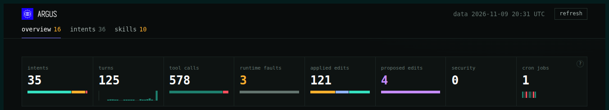
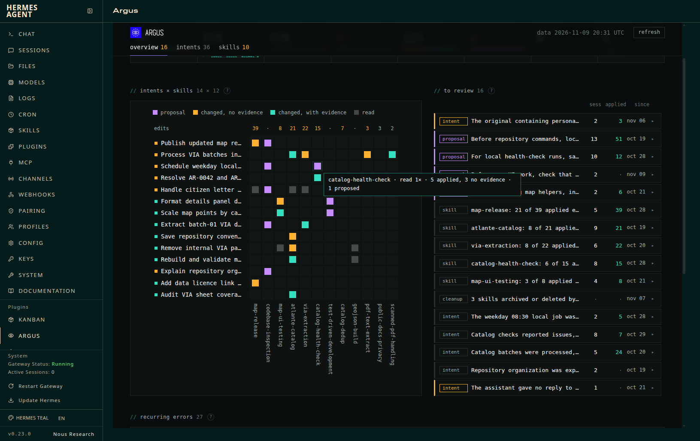
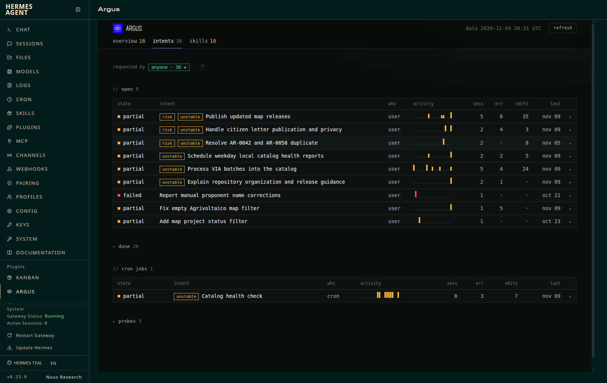
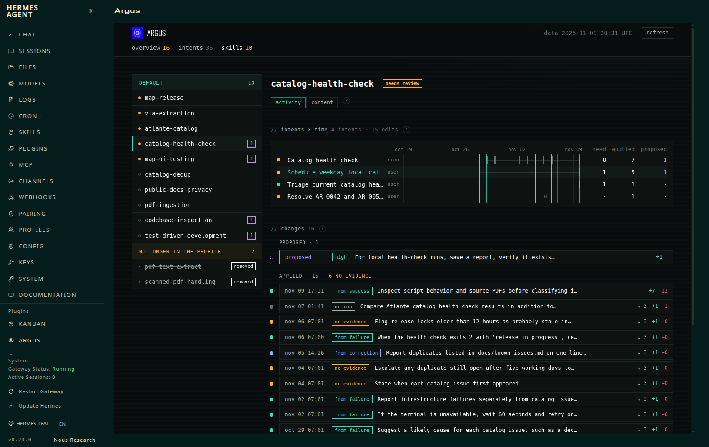
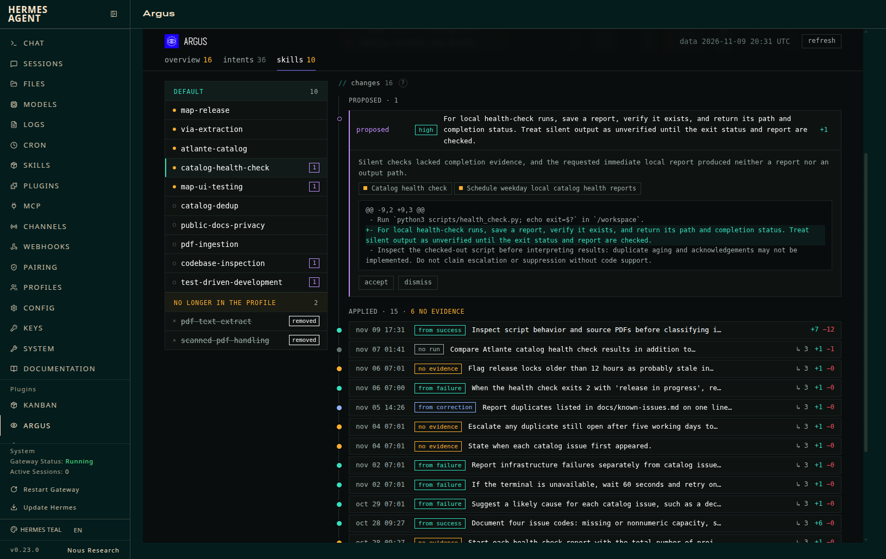
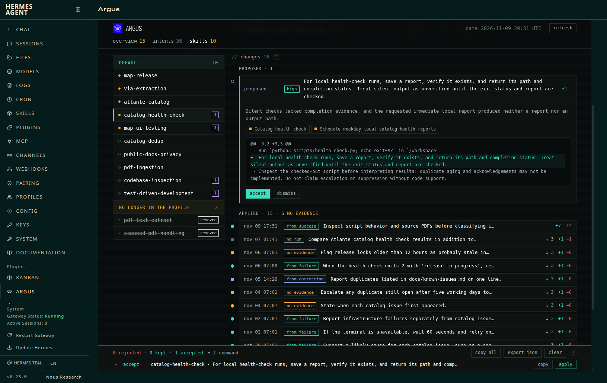
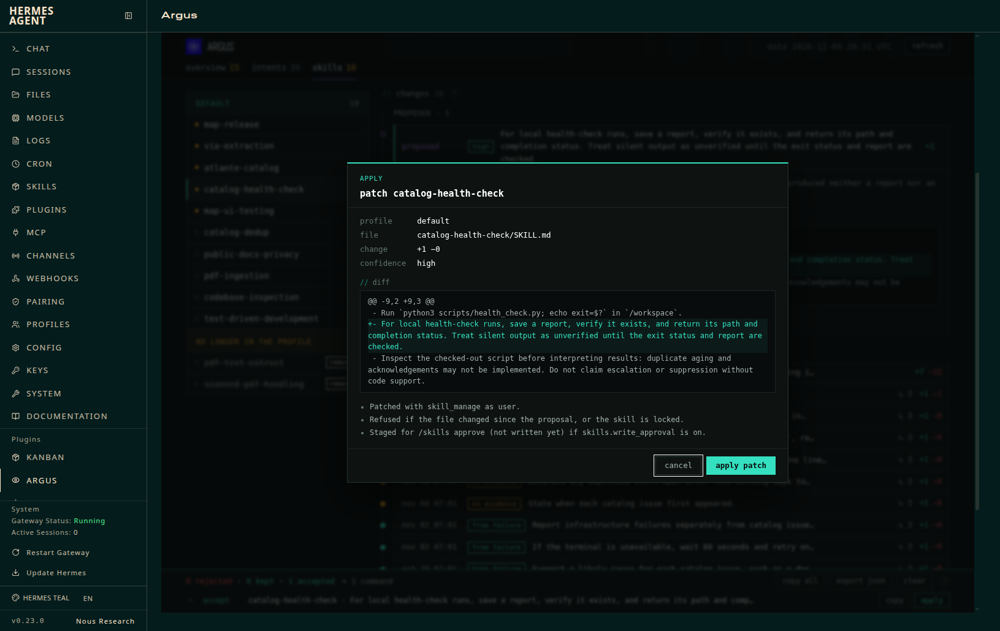
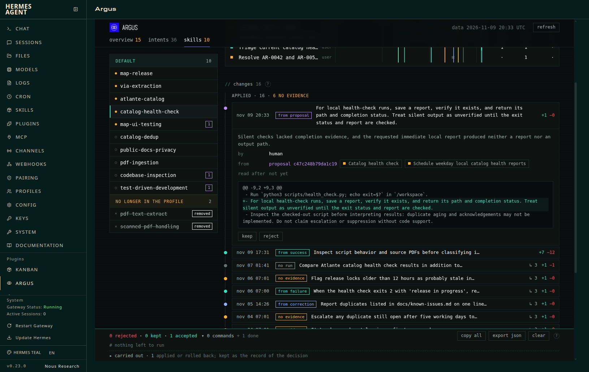
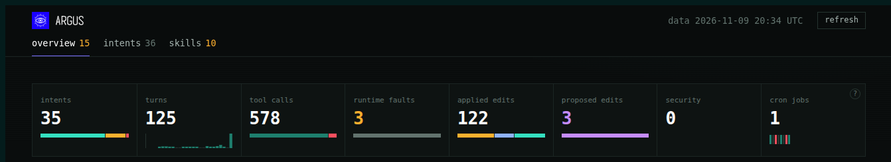

# Showcase: reading an agent by intents, then approving one rule

A Hermes agent works for three weeks (2026-10-19 → 11-09) on *Atlante Rinnovabili*, a fictional map of
Italian renewable-energy projects built from environmental-assessment (VIA) documents: extraction,
catalog fixes, map releases, mostly through Discord with two people, Chiara and Marco, plus a weekday
cron job that checks the catalog. Along the way Hermes keeps editing its own skills. This page follows
the demo video: the numbers, the map of intents and skills, the intents, then one skill, its history
and the rule Argus proposes for it.

## 1. The numbers

Three tabs, each with a count:

- **overview 16**: items waiting for a decision in the review queue.
- **intents 36**: what people asked the agent for, grouped across sessions, the cron job included.
- **skills 10**: skills Hermes changed in this period; amber because some need review.

Below, the key figures: 35 intents (the cron job aside), 125 turns, 578 tool calls, 3 runtime faults,
121 skill edits Hermes applied, 4 edits Argus proposes, no security finding, 1 cron job.

## 2. Intents × skills

Rows are intents, columns the skills they touched. One colour per cell: violet, Argus proposes an edit
to the skill from that intent; amber, Hermes changed the skill there without evidence; teal, with
evidence; grey, the intent only read it. The `edits` row counts the edits Hermes applied to each skill,
amber when some had no evidence. Hovering a cell sums it up: *Schedule weekday local catalog health
reports* read `catalog-health-check` once, Hermes applied 5 edits to it there, 3 without evidence, and
Argus proposes one. On the right, the review queue: risks first, then proposals, then skills drifting
without evidence.

## 3. The intents

The intents tab lists them by state. Open first, 9 of them: partial or failed, with **risk** and
**unstable** marked (*Publish updated map releases*: 5 sessions, 6 tool errors, 35 skill edits). The 26
done are folded, the cron job sits apart (*Catalog health check*: 8 sessions, 3 errors, 7 edits), and so
do the 3 probes. `requested by` filters by who started them: users, the team, tests or cron.

## 4. One skill

The skills tab lists every skill Hermes changed, amber when it needs review, with the number of
proposals next to it. `catalog-health-check` is flagged **needs review**: 6 of its 15 edits have no
evidence.

*intents × time* shows the 4 intents tied to it on one time axis: the cron job read it 8 times and
taught it 7 edits; *Schedule weekday local catalog health reports* 5; *Triage current catalog health
issues* and *Resolve AR-0042 and AR-0058 duplicate* one each. The proposal comes from the first two.

*changes* is the skill's history, newest first: each edit with its evidence class (from a failure,
from a success, from a correction, no evidence, no run), its rule and how many intents read the skill
afterwards. The edits without evidence are policies no run supported: escalate any duplicate still
open after five working days, state when each issue first appeared, flag release locks older than 12
hours as probably stale.

## 5. The proposal

On top sits the edit Argus proposes, with high confidence:

> For local health-check runs, save a report, verify it exists, and return its path and completion
> status. Treat silent output as unverified until the exit status and report are checked.

The reason: silent checks lacked completion evidence, and a requested immediate local report produced
neither a report nor an output path. It cites both intents, the cron job (3 of its 8 runs were silent)
and *Schedule weekday local catalog health reports*. The diff is one line, right after the command that
runs the check.

## 6. Accept

**accept** records the decision in the plugin's database and adds one line to the dock at the bottom.
Nothing runs yet: the dock lists each command still to run, with **copy** (the equivalent
`hermes -z 'Use skill_manage to patch the skill catalog-health-check: …'`) and **apply**.

## 7. Apply

**apply** asks first, showing the profile, the file, the change (+1 −0) and the diff. It patches the
skill through Hermes' own `skill_manage`, as ledger actor `user`. It is refused if `SKILL.md` changed
since the proposal or the skill is locked, and staged for `/skills approve` instead when
`skills.write_approval` is on. The terminal equivalent is
`hermes -p default argus apply --proposal c47c248b79da1c19`.

## 8. Approved

After **refresh**, the proposal has left the proposed list. Its edit is the newest in the skill's
history, marked **from proposal**: written by a person, linked to the proposal and to the two intents
it came from, with the diff that landed. The decision stays in the dock under *carried out*.

Back on the numbers: overview 15, applied edits 122, proposed edits 3. The skill is still flagged
**needs review**: an edit written by a person is left out of that count, and the policies Hermes added
without evidence are still there. Rejecting one of them is the next decision: **reject** adds a
rollback of that ledger entry to the same dock.
